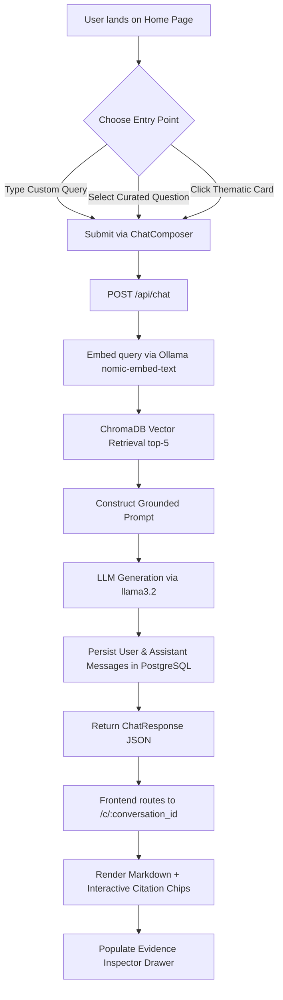
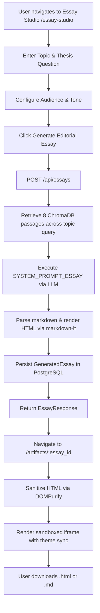

# Product Requirements Document (PRD)
## Lenny Growth Assistant — The Product Intelligence Desk

---

### Document Information
- **Product Name**: Lenny Growth Assistant
- **Product Version**: 1.0.0
- **Document Status**: Production Baseline / Implementation Reference
- **Last Updated**: October 2026
- **Architecture Baseline**: React 19 SPA + FastAPI + PostgreSQL 16 + ChromaDB + Ollama + Docker Compose

---

### 1. Product Overview

**Lenny Growth Assistant** is an authoritative, full-stack AI research assistant and editorial workspace grounded exclusively in transcripts from *Lenny's Podcast*. The product ingests over 300 deep-dive podcast interviews (spanning 32,000+ transcript chunks) with world-class product leaders, growth practitioners, and founders—including Elena Verna, Brian Chesky, Casey Winters, Shreyas Doshi, and Sean Ellis.

Unlike generic chatbot interfaces that hallucinate advice or output superficial AI pleasantries, Lenny Growth Assistant functions as an editorial research desk (named **FIELDNOTES**). It enforces strict citation grounding: every assertion is backed by verbatim transcript passages, speaker attribution, and YouTube episode links. Beyond question-answering, the assistant provides curated topic discovery, a persistent notebook for saved insights, and a long-form **Essay Studio** capable of drafting publication-grade editorial essays (~1,250 words) reminiscent of Lenny Rachitsky's signature *30 for 30* essays.

---

### 2. Problem Statement

Product managers, growth practitioners, and startup founders constantly face high-stakes strategic dilemmas:
- How to structure product-led growth (PLG) loops versus top-down sales funnels.
- How to identify the root causes of cohort retention degradation.
- When and how to pivot upon failing Sean Ellis product-market fit (PMF) benchmarks.
- How to hire and structure high-agency product teams from Series A to IPO.

While *Lenny's Podcast* contains hundreds of hours of tactical advice on these exact challenges, this knowledge is locked in long-form audio and unstructured video transcripts:
1. **Search Inefficiency**: Finding specific frameworks across 300+ episodes requires hours of manual searching and scrubbing through YouTube videos or podcast players.
2. **Generic LLM Hallucinations**: Standard AI assistants (ChatGPT, Claude) lack localized transcript indexing, often conflating general product truisms with actual empirical tactics discussed by domain experts.
3. **Absence of Provenance**: Founders and product leaders cannot pitch strategies to executive teams or boards based on unsubstantiated AI claims; they need exact quotes, speaker attribution, and verified precedent.

---

### 3. Problem Context and Motivation

*Lenny's Podcast* is widely recognized as the preeminent knowledge repository for modern technology product management and growth mechanics. However:
- The sheer volume of material (over 300 episodes, >32,000 text segments, millions of spoken words) makes ad-hoc recall impossible for busy practitioners.
- Traditional keyword searches fail because discussions use nuanced metaphors (e.g., "bouncing off the onboarding wall", "growth loops as closed kinetic systems").
- Practitioners require synthesized, multi-guest perspectives: comparing Elena Verna’s view on B2B product-led sales with Casey Winters’ perspective on virality and retention.

Lenny Growth Assistant solves this by combining local vector search with strict prompt engineering and persistent workspace tools, delivering a zero-fluff, verifiable research environment.

---

### 4. Target Users and Their Needs

| User Persona | Key Responsibilities | Primary Needs & Pain Points | How Lenny Assistant Solves It |
|---|---|---|---|
| **Early-Stage Founder (0 to 1)** | Finding PMF, setting pricing, initial onboarding, first hires. | Needs battle-tested benchmarks (e.g., Superhuman PMF engine, retention flattening) without reading hundreds of blogs. | Delivers immediate, grounded answers with exact episode excerpts and case studies. |
| **Senior Product Manager / Group PM** | Feature prioritization, roadmap trade-offs, stakeholder influence. | Needs clear frameworks to defend strategic decisions to executive leadership. | Provides direct guest quotes (e.g., Shreyas Doshi on "LNO framework") cited with timestamps and links. |
| **Growth Lead / Head of Growth** | Acquisition loops, conversion funnels, paid vs. organic channels, retention curves. | Needs tactical playbooks on cohort retention and loop mechanics rather than high-level definitions. | Synthesizes tactical mechanics across growth leaders (Brian Balfour, Elena Verna, Casey Winters). |
| **Product Operations & Strategy** | Synthesizing organizational strategy, onboarding PMs, compiling executive briefs. | Needs long-form, coherent briefing papers and executive memos. | Uses **Essay Studio** to draft ~1,250-word editorial essays grounded in multiple interview transcripts. |

---

### 5. Product Goals

1. **Absolute Grounding & Verifiability**: Every factual claim must cite specific podcast passages (`[S1]`, `[S2]`) with episode titles, guest names, verbatim excerpts, and YouTube links.
2. **Honest Boundary Enforcement**: When transcript evidence is insufficient, the system must explicitly state: *"Lenny's Podcast library does not contain sufficient transcript evidence on this topic."* rather than hallucinating external knowledge.
3. **Editorial Quality & Tone**: Output must read with analytical rigor, clarity, and pragmatic elegance, avoiding generic introductory pleasantries and filler text.
4. **End-to-End Persistence**: All inquiries, conversation threads, bookmarked takeaways, and generated essays must persist reliably across sessions using PostgreSQL.
5. **Local-First, Privacy-Preserving Architecture**: The core system runs entirely on developer hardware via Docker Compose and local Ollama inference (`llama3.2` + `nomic-embed-text`) with zero mandatory external API dependencies.
6. **Multi-Model Flexibility**: Optional integration support for frontier cloud models (OpenAI GPT-4o-mini, Anthropic Claude 3.5 Sonnet) when API keys are configured.

---

### 6. Non-Goals and Out-of-Scope Features

The following capabilities are deliberately outside the current scope of this release:
- **Audio/Video Playback**: The app links out to YouTube with timestamps; it does not stream audio or host MP4/MP3 media players.
- **Dynamic User Authentication / Multi-Tenancy**: The application is designed as a single-workspace developer studio. It does not implement multi-tenant auth (OAuth2/JWT/login walls).
- **Automated YouTube Scraping**: Ingestion runs against a local corpus of transcripts (`lennys-podcast-transcripts/episodes`). Live web scraping or automated YouTube downloading is out of scope.
- **Arbitrary Web Search**: The assistant does not search Google or Wikipedia; its knowledge horizon is strictly bounded by the podcast transcript library.
- **Real-Time Token Streaming**: The current API returns full synchronous JSON responses (`ChatResponse`); streaming server-sent events (SSE) are reserved for future roadmap iterations.

---

### 7. Core Features and Requirements

#### 7.1. Conversational RAG Research Desk
- **Prompt Composer**: Auto-expanding input with keyboard shortcuts (`Enter` to submit, `Shift+Enter` for newline) and predefined prompt suggestions.
- **Bracket Citation Rendering**: Inline citation tokens (e.g. `[S1]`, `[S2]`) parsed into interactive badge chips in real time.
- **Thread Management**: Auto-generation of conversation titles from the initial user query; conversation renaming and deletion.
- **Session Persistence**: Full message history stored in PostgreSQL and retrieved on navigation.

#### 7.2. Interactive Evidence Inspector ("The Evidence")
- Collapsible side panel displaying all retrieved ChromaDB passages for the active turn.
- Displays metadata: Citation identifier (`S1`, `S2`), episode title, guest name, verbatim passage excerpt, publish date, YouTube URL, and normalized relevance score (derived from vector distance).
- **Two-Way Interaction**: Clicking an inline citation chip in the message body auto-scrolls the evidence drawer to the corresponding source card and applies active visual highlighting.

#### 7.3. Curated Topic Discover Desk
- Pre-built index of core domain verticals:
  1. Growth Loops & Viral Engine
  2. User Retention & Churn
  3. Product Strategy & Roadmaps
  4. Product Management Craft
  5. Product-Market Fit
  6. Hiring & High-Performing Teams
- Searchable filter for quick topic lookup.
- Curated sample questions that immediately launch new research inquiries.
- Live source preview pane retrieving actual transcript passages for each topic.

#### 7.4. Saved Insights Notebook
- Bookmark key synthesis messages directly from the research chat.
- Dedicated notebook page (`/saved-insights`) listing saved cards with verbatim excerpts, topic tags, and timestamps.
- One-click clipboard copy and card deletion.

#### 7.5. Long-Form Essay Studio & Artifact Viewer
- Long-form composition desk tailored after Lenny’s *30 for 30* publication style.
- User inputs: Topic, Central Question/Thesis, Target Audience, and Editorial Tone.
- Retrieves 8 diverse evidence passages and generates a ~1,200 to 1,300 word structured essay (Headline, Subtitle, 4-5 thematic sections, inline citations, tactical trade-offs, and "The Bottom Line for Builders").
- **Sandboxed Artifact Viewer (`/artifacts/:id`)**: Renders essay HTML inside an isolated `<iframe>` sanitized via `DOMPurify` to eliminate XSS risks; provides Markdown viewing toggle and `.html`/`.md` download options.

#### 7.6. Model & Provider Management
- Supports local inference via Ollama (`llama3.2` + `nomic-embed-text`).
- Modular configuration for OpenAI (`gpt-4o-mini`) and Anthropic (`claude-3-5-sonnet-20241022`).
- Interactive modal (`ModelSelectorModal`) displaying provider status, local privacy badges, and configuration flags.
- Strict error propagation: if a chosen provider is unreachable or missing keys, the system returns clear actionable errors rather than silently substituting models.

---

### 8. User Stories

| ID | User Role | User Story | Acceptance Criteria |
|---|---|---|---|
| **US-01** | Founder | As an early-stage founder, I want to ask how top consumer startups measure retention, so that I can validate whether our current 30-day cohort curve indicates true product-market fit. | System retrieves relevant excerpts (e.g., Casey Winters, Sarah Tavel), cites them as `[S1]`, `[S2]`, and displays exact retention thresholds. |
| **US-02** | Product Manager | As a PM, I want to click on inline citations in the synthesis answer, so that I can verify the exact quote and context directly against the transcript before presenting it. | Clicking `[S1]` opens the Evidence Drawer, scrolls directly to `S1`, and highlights the card. |
| **US-03** | Growth Lead | As a growth lead, I want to explore curated topics in the Discover section, so that I can quickly discover relevant questions without formulating a prompt from scratch. | Navigating to `/discover` shows 6 thematic domains with clickable questions that launch a new inquiry. |
| **US-04** | Product Leader | As a VP of Product, I want to save high-signal takeaways into a personal notebook, so that I can reference them during quarterly planning sessions. | Clicking "Save Insight" persists the message and sources into PostgreSQL and displays them on `/saved-insights`. |
| **US-05** | Strategist | As a strategist, I want to generate a 1,250-word editorial essay on "Product-Led Sales Dynamics", so that I can distribute an executive brief to leadership. | Essay Studio retrieves 8 passages, produces a structured ~1,250-word essay with citations, and renders it safely in the Artifact Viewer. |
| **US-06** | Developer | As an engineer deploying the assistant, I want to boot the entire stack with a single command, so that I don't have to configure database connections manually. | Running `docker compose up --build` launches PostgreSQL, backend, and frontend containers in a healthy state. |

---

### 9. User Flows

#### 9.1. Core Research Inquiry Flow


#### 9.2. Evidence Inspection Flow
```mermaid
graph TD
    A[User reads synthesis answer] --> B[User clicks [S1] chip]
    B --> C[Frontend triggers onCitationClick('S1')]
    C --> D[Open SourcePanel drawer if closed]
    D --> E[cardRefs['S1'].scrollIntoView]
    E --> F[Apply active highlighted CSS style]
    F --> G[User clicks Watch Episode]
    G --> H[Open YouTube video with timestamp in new tab]
```

#### 9.3. Essay Generation & Artifact Flow


---

### 10. Functional Requirements

#### 10.1. Vector Store & RAG Pipeline
- **FR-1.1**: The system shall connect to an existing ChromaDB persistent client at `CHROMA_DB_PATH` targeting collection `lenny_podcast`.
- **FR-1.2**: If the collection does not exist or is empty, the system shall fail with an explicit diagnostic error rather than silently initializing an empty collection.
- **FR-1.3**: The system shall generate 768-dimensional query embeddings using Ollama's `nomic-embed-text` model.
- **FR-1.4**: Chat retrieval shall fetch the top 5 most similar passages using cosine distance; Essay retrieval shall fetch the top 8 passages.
- **FR-1.5**: Retrieved passages shall include: `title`, `guest`, `youtube_url`, `publish_date`, `chunk_index`, and verbatim text `excerpt`.
- **FR-1.6**: Distance metrics shall be normalized to a relevance score: `relevance_score = max(0.0, round(1.0 - distance, 4))`.

#### 10.2. LLM Inference & Generation
- **FR-2.1**: The default inference model shall be Ollama `llama3.2` running at `OLLAMA_BASE_URL`.
- **FR-2.2**: The chat system prompt shall enforce citation rules, attribute statements to named guests, and disallow speculation or hallucinated facts.
- **FR-2.3**: If passages contain insufficient evidence, the model shall explicitly state that Lenny's Podcast library lacks sufficient transcript evidence.
- **FR-2.4**: Cloud providers (OpenAI, Anthropic) shall only be invoked if their respective API keys are present in environment variables.

#### 10.3. Session & Data Persistence
- **FR-3.1**: The backend shall persist all conversations and messages in PostgreSQL using SQLAlchemy 2.x models.
- **FR-3.2**: When `REQUIRE_POSTGRES=true`, the backend shall retry PostgreSQL connections up to 5 times and refuse to start if PostgreSQL is unreachable.
- **FR-3.3**: In local development (`REQUIRE_POSTGRES=false`), if `DATABASE_URL` is omitted, the system shall fall back to local SQLite with explicit logging.
- **FR-3.4**: Deleting a conversation shall cascade-delete all associated messages.
- **FR-3.5**: Updating a conversation title via `PATCH /api/conversations/{id}` shall persist immediately.

#### 10.4. Frontend Client
- **FR-4.1**: The client shall be a single-page application built with React and React Router v7.
- **FR-4.2**: The client shall maintain light and dark themes using CSS variables and persist the preference in `localStorage`.
- **FR-4.3**: Bracket citations matching `/\[(S\d+)\]/g` in markdown text shall render as interactive buttons.
- **FR-4.4**: All API communication shall route through a centralized API service with structured error handling.
- **FR-4.5**: In Docker environments, API requests shall be reverse-proxied through Nginx at `/api/`.

---

### 11. Non-Functional Requirements

- **Performance**:
  - Vector similarity search across 32,325 chunks must complete in under 150ms.
  - Initial frontend production bundle must be under 200 KB gzipped (actual: 160.14 KB JS, 4.66 KB CSS).
- **Security**:
  - Zero hardcoded API keys, passwords, or credentials in source code.
  - All generated HTML rendered in the Artifact Viewer must be sanitized via `DOMPurify` (disallowing `<script>`, `<iframe>`, `<object>`, `<embed>`).
  - The Artifact Viewer `<iframe>` must use `sandbox="allow-same-origin"` without script execution permissions.
  - Database queries must execute through SQLAlchemy ORM parameterization to prevent SQL injection.
- **Reliability & Resilience**:
  - Docker Compose containers must implement explicit health checks (`pg_isready`, `curl -f /api/health`, `wget -q --spider`).
  - Backend must handle Ollama connection interruptions gracefully, returning HTTP 502/503 with user-friendly error messages rather than crashing.
- **Maintainability & Portability**:
  - Zero machine-specific absolute file paths in code or configuration.
  - Reproducible container builds using multi-stage Dockerfiles.

---

### 12. Success Metrics

| Metric | Target | How It Is Measured |
|---|---|---|
| **Citation Precision** | 100% of factual claims cite valid `[Sx]` tokens | Automated regex audit and manual verification of generated answers against retrieved passages. |
| **Grounded Provenance** | 0% hallucinated guest names or URLs | Verification that every cited guest matches the episode metadata in the vector database. |
| **Health Check Latency** | < 50ms | `GET /api/health` response duration monitoring. |
| **End-to-End Inquiry Latency** | < 3.5s (local Ollama GPU) | Total time from `ChatComposer` submit to complete rendered response. |
| **Test Coverage Integrity** | 10/10 automated tests passing | `pytest` test suite execution across models, DB CRUD, RAG flow, and essay generation. |

---

### 13. Assumptions and Constraints

- **Hardware Constraint**: Running local Ollama inference (`llama3.2` + `nomic-embed-text`) requires an Apple Silicon Mac (M1/M2/M3/M4 with ≥16GB Unified Memory) or an equivalent GPU-accelerated Linux/Windows workstation.
- **Docker Host Networking**: In Docker Compose on macOS, the backend accesses host-based Ollama via `host.docker.internal:11434` enabled by `host-gateway`.
- **Corpus Boundedness**: The system's knowledge is bounded by the static corpus ingested into ChromaDB (303 episodes). It does not dynamically auto-index newly released episodes unless `ingest.py` is re-run.

---

### 14. Acceptance Criteria for Core Features

#### Feature 1: Grounded Conversational RAG
- **Given** a user asks "Why do users churn after onboarding?",
- **When** the backend queries ChromaDB,
- **Then** it must retrieve relevant passages from guests who discussed onboarding (e.g. Adam Fishman, Elena Verna),
- **And** format the response with `[S1]`, `[S2]` tokens corresponding to the retrieved excerpts,
- **And** populate the Evidence Inspector with complete metadata.

#### Feature 2: Out-of-Domain / Insufficient Evidence Query
- **Given** a user asks a question completely unaddressed in the podcast (e.g., quantum computing algorithms),
- **When** the retrieved passages have poor relevance scores,
- **Then** the assistant must explicitly answer: *"Lenny's Podcast library does not contain sufficient transcript evidence on this topic."*

#### Feature 3: Long-Form Essay Generation
- **Given** a user requests an essay on "Growth Loops",
- **When** the LLM generates the response,
- **Then** the resulting markdown must contain an H1 title, subtitle, 4-5 H2 sections, inline citations, and "The Bottom Line for Builders",
- **And** word count must be between 1,000 and 1,500 words,
- **And** it must be accessible via `/artifacts/:id`.

---

### 15. Risks and Mitigations

| Risk | Impact | Likelihood | Mitigation Strategy |
|---|---|---|---|
| **Ollama Service Down on Host** | Backend fails to generate embeddings or answers. | Medium | Backend `health.py` reports `"ollama": {"status": "unavailable"}` and returns HTTP 502 with installation URL link. |
| **Large ChromaDB File Bloat (>100MB)** | GitHub blocks git push operations. | High | Git LFS installed and configured for `chroma.sqlite3` and `*.bin` files via `.gitattributes`. |
| **XSS via LLM-Generated HTML Artifacts** | Malicious script execution in Artifact Viewer. | Medium | Strict `DOMPurify` HTML sanitization stripping all script/embed tags combined with sandboxed iframe. |
| **PostgreSQL Container Startup Delay** | Backend fails on startup due to database not ready. | Medium | Docker Compose `depends_on: postgres: condition: service_healthy` + backend connection retry loop (5 retries with 2s backoff). |

---

### 16. Implementation Plan and Current Status

| Component | Status | Verification Reference |
|---|---|---|
| ChromaDB Vector Store (32,325 chunks) | **Complete & Verified** | `chroma_db/` indexed with `lenny_podcast` collection. |
| FastAPI Backend Core & Routers | **Complete & Verified** | `backend/app/main.py`, 8 active routers under `/api`. |
| PostgreSQL Persistence & Migrations | **Complete & Verified** | SQLAlchemy models + Alembic `4fd33d2bc4d3_initial_schema.py`. |
| Ollama RAG Pipeline (Llama 3.2 + Nomic) | **Complete & Verified** | `rag_service.py`, `llm_service.py`. |
| FIELDNOTES React 19 Frontend | **Complete & Verified** | `frontend/src/`, all 6 pages and 10 components operational. |
| Evidence Drawer & Interactive Citations | **Complete & Verified** | `Citation.jsx`, `SourcePanel.jsx`, auto-scroll & highlighting. |
| Essay Studio & Artifact Viewer | **Complete & Verified** | `EssayStudioPage.jsx`, `ArtifactPage.jsx`, `DOMPurify` sandbox. |
| Docker Compose Multi-Container Stack | **Complete & Verified** | `docker-compose.yml` (Postgres, Backend, Frontend + Nginx). |
| Real-Time Streaming Responses (SSE) | *Roadmap Enhancement* | Currently synchronous request-response. |
| Multi-Turn Memory in LLM Prompt | *Roadmap Enhancement* | Thread history persisted in DB; current prompt uses single-turn evidence. |
